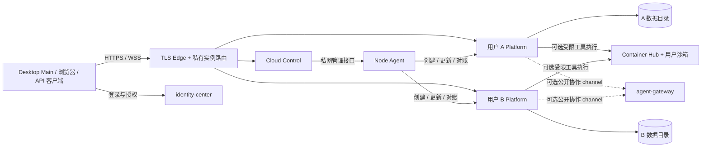
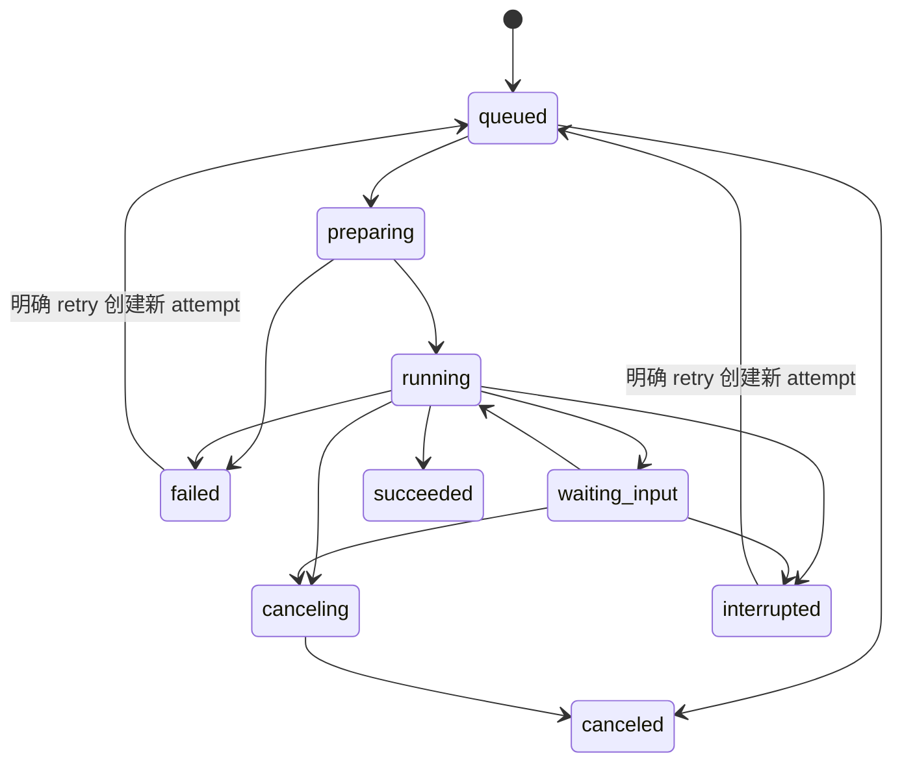

# 云端部署与持续任务架构设计

状态：设计提案，尚未实现。基线日期：2026-10-13。本文依据当前 Platform 源码、正式分发 lock 和相邻服务的契约整理；本文新增的配置、API、模块与发布命令均为拟议项，不能作为已交付能力使用。

## 1. 目标与架构决策

目标是把 Platform 和完整 builtin 制成 Linux 成品，在云端直接部署；每个用户拥有独立执行实例、凭据和数据；Desktop 可以提交云端任务，关机后任务继续执行，再次上线可以读取过程、审批和产物。

第一版采用单台 Linux 云服务器、一个通用 OCI 镜像、多用户独立实例、独立持久数据目录。身份复用 identity-center。新增独立 Cloud Control 服务管理实例与节点；Platform 继续负责 Agent 执行。先使用 Docker/Podman 与本地持久存储，不引入 Kubernetes、外部数据库或消息队列。以后扩展节点时保持接口和实例身份不变。

主要决策：

| 事项 | 决策 |
| --- | --- |
| 发布 | 在本地构建环境或 CI 制作 Linux 成品，服务器只导入/拉取镜像 |
| builtin | 沿用受验证的 cache、manifest 和完整连接器包，不把周边源码作为部署依赖 |
| 用户体系 | 共享身份中心，一用户一个独立 Platform 实例；实例内部校验固定 owner |
| 网络入口 | HTTPS/WSS；实例使用不含用户名的子域名；控制服务统一管理路由 |
| 任务归属 | 云端 Job 和 Run 是执行事实；Desktop 是观察者和缓存 |
| 后台执行 | 复用现有独立 Run context、WS detached、attach/detach；增加持久 Job 接受与查询 |
| 容错 | 首版保证 Desktop 离线续跑；Platform 重启后旧 Run 仍取消，Job 明确记录中断 |
| 本地转云端 | 新任务直接在云端启动；已执行任务通过显式交接启动新 Run |
| 权限 | 保留现有 AccessPolicy/HITL/readonly 规则；云端位置不提高 Agent 权限 |
| 数据 | 云端 Workspace、Chat、Memory、KBX 和凭据独立持久化；结果按需同步 |

“一用户一容器”在 Host 执行模式下对应一个 Platform 容器；启用工具沙箱时，可以另有该用户所属的工具容器，全部计入用户资源限额。同一镜像层可以复用，运行数据与秘密不得共享。

## 2. 已有能力与真实缺口

| 检查项 | 当前证据与结论 | 本次需要补充 |
| --- | --- | --- |
| 镜像入口 | 根 Dockerfile 已有 Go 多阶段构建、非 root UID 10001、healthcheck；COPY 指向 Linux builtin cache | Linux 成品、验证步骤与离线 image bundle |
| 发布边界 | release-program 只消费 build/builtins/<os>-<arch>，不再构建相邻源码 | 镜像发布沿用相同边界 |
| Linux 支持 | linux/amd64 已可通过 `scripts/sync-linux-builtins.sh` 在构建容器内同步；linux/arm64 仍拒绝；KBX 0.1.2 起 release.py 自带 Linux 目标，Platform 的 build-kbx.py 在构建容器内原生编译并复用其 ELF 校验与归档格式；2026-10-13 在真实 Ubuntu 主机完成基础部署、中文 PDF 全文检索和索引持久化验收 | arm64、模型相关功能与完整部署验收 |
| 完整 builtin | 正式 lock 已登记 rg、KBX、memx、Poppler、dbx、httpx 的 linux-amd64 payload；真实 Linux 镜像已验证 PDF 抽取、KBX 全文建库与检索、真实 embedding 的严格向量检索、`/healthz`、真实聊天模型、挂载 Agent 的 httpx 调用、Memory 采集及独立历史样本的非空摘要链路 | Platform 当日会话的跨日自动摘要发布及其他未验证项见服务器验收记录 |
| 配置保密 | `.dockerignore` 已改为白名单，只放行 Go 源码、Linux builtin cache 与示例配置 | 新增镜像内容时显式放行 |
| 长任务 | Runtime 已把执行与 observer 分离；main WS /api/query 支持 detached:true | 增加持久接受、状态查询及提交重试对账 |
| 断线观察 | /api/detach 不 interrupt；/api/attach 支持 lastSeq；proxy 有 observer independence 测试 | 持久远端身份和离线事件增量同步 |
| HTTP detached | POST /api/query 的 detached:true 当前明确返回 detached_ws_required | 新 Job API 或明确版本化扩展，不能按现有 HTTP 字段调用 |
| Proxy | 支持 WS/SSE、控制转发、Chat 记录和附件物化；路由仅存在于进程内 | durable Job 适配、凭据提供接口、独立远端任务投影 |
| 身份 | JWT 当前验证 RS256、配置 issuer、可选 exp；没有实例 owner/audience 准入合同 | 云端强制 sub、aud、instanceId、有效期、权限和实例 owner 校验 |
| WS token | WebSocketTarget 同时把 token 放入 Authorization 和 URL query | 云端连接只用 Header 或专用握手票据 |
| 凭据落盘 | Provider apiKey 当前按明文配置读取 | 加密保存、最小披露、独立工作负载授权 |
| 重启 | restart_runs.go 明确取消所有未完成 Run，清理等待项，不恢复执行器 | Job 对账中断；自动续执行作为后续独立能力 |
| 目录与版本 | ru-agents/ru-skills 是进程内版本目录；重启重建，不能持久 pin | Job 保存审计快照，不借此恢复旧执行版本 |
| Gateway | 相邻 agent-gateway 已有租户、ACL、路由绑定、资源中转，但限制管理接口、Workspace、Teams 等 | 私有完整 Platform 接入单独设计；不得整体放宽公开 Gateway allowlist |

现有源码依据：Dockerfile、compose.yml、scripts/sync-local-builtins.sh、scripts/release-assets/{builtins,connectors}.lock.json、internal/runtime/query/{start,restart_runs}.go、internal/server/{ws_query_routes,handler_query,security}.go、internal/runtime/proxy/{protocol,driver,materialize}.go。行为详见 [API 与协议](API与协议.md)、[鉴权与安全边界](鉴权与安全边界.md)、[版本化打包](版本化打包方案.md)。设计初稿只做了静态核对；后续 linux/amd64 镜像已构建并通过真实服务器的小样本部署验收，范围与未验证项见 [Linux 服务器验收记录](版本化打包方案.md#linux-服务器验收记录)。

## 3. 服务边界与部署拓扑



职责分配：

- identity-center：唯一用户身份源、设备身份、实例访问令牌及受限云端委托。云端不为每个容器建立独立账号库。
- TLS Edge：证书、HTTPS/WSS、Host 校验、请求限制。可以沿用已有 Nginx，也可采用 Caddy；证书与容器生命周期分开。
- Cloud Control：owner→instance 映射、镜像版本、配额、目标节点、路由、实例操作收据、健康聚合、备份编排。首版单活、SQLite；不保存聊天全文或模型工具循环。
- Node Agent：只接受认证控制服务的固定操作，把允许的镜像、目录和资源模板落实为 Docker/Podman 调用。持有节点级权限，用户容器不持有该权限。首版可以作为 Cloud Control 的本机适配器，协议预留独立进程。
- Platform：实例身份准入、目录 catalog、Job/Run 生命周期、审批、自动化、知识库、Memory、资源和产物。
- Desktop Main：身份交换、目标发现、文件传输、远端事件同步、Keychain/安全存储。renderer 只接收数据与连接引用。
- Container Hub：仍是工具沙箱执行服务，不能把当前 environment/session 接口直接等同于租户实例编排。
- agent-gateway：按既有 allowlist 做公开 Agent/协作投影；个人实例完整 API 使用独立受 owner 授权的路由。两种入口不能混用凭据与访问范围。

共享 Edge 后增加实例时只更新实例注册表。流量经私有路由服务查询 instanceId→内部上游，避免每次创建用户都重载全部 Edge 配置。查询目标只能来自受管注册表，不接受客户端提供的任意 upstream URL。

需要云端网页界面时，agent-webclient 以独立版本化静态产物/镜像部署，个人实例入口同源代理其静态资源与所属 Platform API；Platform runtime 镜像不隐式携带整个 Desktop。身份中心、Edge、Control、可选 WebClient 是共享部署组件，不能在每个用户容器里重复安装。

## 4. 完整镜像与离线发布

### 4.1 产物链路

```text
相邻 builtin 源码与依赖（只存在于开发机/CI）
  → 对应 Linux 原生 builder 的正式 archive + SHA + 许可证
  → Platform 同步与验证
  → build/builtins/linux-amd64（先支持这一目标）
  → Linux program bundle（Go runtime + 完整 builtin + 模板）
  → 成品最小上下文 + runtime Dockerfile
  → OCI image
  → registry 按 digest 发布 / docker save 离线归档
  → 云服务器 pull / load
```

服务器无需 Go/Rust 编译器、Platform checkout 或任何相邻源码。若本机是 macOS，可以在本机 Linux VM、容器 builder 或 CI 制作 Linux 产物；本机 Darwin 产物不能直接放入 Linux 镜像。CPU 架构也必须匹配。Docker 的多平台构建支持目标架构选择，但不会把已有 Darwin CLI 转换成 Linux CLI。参见 [Docker 多平台构建](https://docs.docker.com/build/building/multi-platform/)。

必须保留正式 lock 的原生 host、精确 yes、干净版本、稳定 archive、并发校验规则。推荐 Linux 原生 runner 为 Linux 目标登记；交叉构建仍不得写其他平台 SHA。新增 Linux 目标要在 builtin 来源项目实现，不由 Platform 临时重编一个版本替代正式分发。

镜像内容：

| 位置 | 内容与来源 |
| --- | --- |
| /opt/backend/agent-platform | CGO_ENABLED=0 的 Go runtime |
| /opt/bin | 对应 Linux 目标的 rg/kbx/memx 等受管 CLI |
| /opt/connectors | dbx/httpx 完整来源包，包括 bin/libs、skills、references、assets |
| /opt/libexec | Poppler launcher/runtime/data，按正式 payload 整体复制 |
| /opt/licenses | 每个 builtin 的许可证和第三方 notice |
| /opt/manifest.json、builtins.manifest.json | 版本、平台、实际 checkout 和 payload 摘要 |
| /opt/config-templates | 通用非秘密模板；真实配置通过部署挂载 |

Platform 内嵌的 builtin.desktop、platform-control、task-control、kbase-control 等随 Go runtime 提供；保留包内容不表示没有 Desktop 时其所有动作都可用。可选 ACP bridge/plugin 不属于普通 builtin 完整镜像的隐式依赖，启用时必须另有 Linux 成品和验收。

纯运行镜像只包含 Platform/builtin 的运行依赖。Python、Node、Git、Office、浏览器等属于明确的工具环境模板；需要这些能力的任务选择包含它们的镜像，不能以减小包为由静默缺失任务依赖。逐项验证 CLI 动态链接库、加载器、字体/数据文件和 CA，而非只检查 --version。

### 4.2 发布接口与保密

make release-image 已实现：复验目标 cache 后构建，build context 由白名单 `.dockerignore` 限定。Dockerfile 不读取相邻工程、不编 Rust、不读取真实 .env/configs/runtime/凭据。单主机入口采用主机 nginx 加通配证书（`scripts/release-assets/ingress-nginx/`），每个实例一行路由，不引入独立入口服务；该入口已于 2026-10-13 在一台服务器启用并通过外部访问验证。Platform 已提供可选的实例绑定（`auth.audience`、`auth.allowed-subjects`、`auth.require-expiry`）与固定公网地址（`resource.public-base-url`），默认不启用；PROXY 上游 WebSocket 的 token 改为只走请求头与 bearer 子协议，不再写入 URL；`/ws` 接受 `Authorization` 头。浏览器等客户端仍可用 URL 查询参数传 token，identity-center 尚未签发面向具体实例的 audience。

镜像 tag 用于人类识别，实例锁定 imageDigest。离线发布目录建议：

```text
agent-platform-image-<version>-linux-amd64/
  images/agent-platform.tar.gz
  manifest.json
  checksums.sha256
  compose.example.yml
  configs/*.example.yml
  load.sh
  verify.sh
  DEPLOY.md
```

不包含用户数据、模型 API key、JWT 私钥、TLS 私钥或真实配置。需要私有依赖的构建只使用 BuildKit secret mount，不能把 token 放入 ARG/ENV 或复制后再删除。参见 [Docker build secrets](https://docs.docker.com/build/building/secrets/)。

以下为各步骤的等价手工命令；`make release-image` 已把构建、smoke、归档和部署文件打成一个发布目录，服务器侧执行其中的 `load.sh` 与 `docker compose up -d`：

```bash
# 构建机：在构建容器内准备并验证 linux/amd64 cache。
make sync-builtins-linux

# 构建机：当前 Dockerfile 可用的单目标构建形式；正式发布应走上述最小上下文。
docker buildx build --platform linux/amd64 --load -t agent-platform:cloud-v1 .
docker image save agent-platform:cloud-v1 | gzip > agent-platform-cloud-v1-linux-amd64.tar.gz
shasum -a 256 agent-platform-cloud-v1-linux-amd64.tar.gz > agent-platform-cloud-v1-linux-amd64.tar.gz.sha256

# 云服务器：上传归档与摘要后核对，导入镜像。镜像加载不需要源码。
sha256sum -c agent-platform-cloud-v1-linux-amd64.tar.gz.sha256
docker image load -i agent-platform-cloud-v1-linux-amd64.tar.gz
# 使用在服务器生成的部署配置与私有数据目录启动；部署 Compose 必须没有 build 节。
docker compose -f compose.deploy.yml up -d --no-build
```

docker save/load 支持成品传输，load 可以读取 gzip 压缩归档。参见 [镜像保存](https://docs.docker.com/reference/cli/docker/image/save/) 与 [镜像加载](https://docs.docker.com/reference/cli/docker/image/load/)。也可在 CI 推送私有 registry 后按 digest 拉取，减少重复上传公共镜像层。

约 100 MB 的已有压缩 program bundle 与镜像压缩包、镜像展开大小、用户数据是不同指标。Debian 基础层、Linux 原生库和工具环境会影响大小，应以实际产物测量；不承诺完整镜像也一定低于 100 MB。

## 5. 实例管理、目录和隔离

### 5.1 实例模型

Cloud Control 持久保存 instanceId、ownerSubject、nodeId、imageDigest、desiredState、observedState、routeHost、storageRef、configRevision、resourceProfile、generation、健康时间、操作收据。ownerSubject 取已验证身份，不接收请求体覆盖。首版一个 owner 一个活动实例；之后允许一个 owner 多实例，权限以实例为单位。

实例状态：provisioning→running→draining→stopped；失败为 failed；删除为 deleting→deleted。删除实例与删除数据是两个显式操作，停止/更新不删除持久卷。

创建顺序：持久记录与目录分配→配置/Secret 准备→镜像验证→容器启动→内部 readiness→发布路由→返回 ready。失败撤销对外路由并保留诊断。desired/observed 对账使用单实例串行锁和 generation，重复操作幂等；Control 重启根据实例记录和容器标签对账，不能创建第二个写同一数据目录的 Platform。

拟议控制接口使用统一 {code,msg,data}：POST/GET /api/cloud/instances（创建与列出自己的实例）、GET /api/cloud/instances/<id>（状态和允许的公网 endpoint）、POST /api/cloud/instances/<id>/start|stop|upgrade|backup（幂等操作）、GET /api/cloud/operations/<operationId>（进度），以及明确的数据销毁接口。镜像只能选已登记的 release，不能传任意 image/command/mount；owner 和 node 凭据不由前端指定。节点管理接口仅私网可用并认证 workload，用户实例 token 没有实例生命周期权限。

健康区分进程存活、实例可准入、存储/关键 builtin 可用；故障实例停止接受新任务但保留读取已提交结果的能力。监控 CPU/OOM、磁盘、Job 排队和中断、模型失败、TLS 续期与授权刷新；日志只记录必要的脱敏关联 ID，不输出 token、聊天正文或凭据文件。实例有排队任务、活动 Run 或审批时不能因 Desktop 离线自动休眠。

### 5.2 持久数据

```text
/srv/agent-cloud/
  control/control.db
  users/<opaque-owner-id>/instances/<instance-id>/
    configs/                     → /opt/configs（只读挂载）
    runtime/                     → /opt/runtime
      agents/ skills-center/ connectors-center/ registries/
      chats/ memory/ pan/ owner/ .state/ automations/
      kbases/ ru-kbases/          # 定义与 KBX 数据，均保留
    workspaces/                  → /opt/workspaces
    backups/
```

这里只表示部署目录布局，实际子目录继续由现有 config 默认和 AP_RUNTIME_DIR 派生。若需要覆写，只使用现有 AP_RUNTIME_* allowlist，不恢复 runtime.yml paths。Job 数据建议放在有效 StateDir/jobs.db，配置不增加另一套 paths。

ru-agents/ru-skills 等执行组装产物遵循现有重建规则；ru-kbases 是持久数据，不能按 ru-* 批量清理。一个实例只允许一个 Platform writer。项目 Agent 的 workspaceRoot 必须是云端现存具体目录，如 /opt/workspaces/project-a；创建继续调用现有 isProject:true 契约。

### 5.3 运行安全

- 容器不映射用户端口到公网；只允许 Edge/私有路由访问内部 8080。公网仅暴露 TLS 入口和必要的运维入口。
- 镜像固定非 root、drop capabilities、no-new-privileges、默认 seccomp；只读 rootfs，/tmp 使用受限 tmpfs，runtime/workspaces 是用户专属可写挂载。HOME/缓存目录需要落到明确可写的用户目录并做 smoke check。
- 禁止 privileged、host PID/network、宿主根挂载和 Docker socket；镜像/挂载/env/启动参数只来自控制服务模板。
- 限制 CPU、memory、pids、磁盘、任务并发和产物大小。磁盘配额需由宿主文件系统或节点服务实际执行，普通 Docker volume 不等于有配额。
- 对用户容器做跨实例网络隔离；默认不能访问其他用户、节点管理 API、内部 Secret 服务或云元数据。出站模型/连接器访问通过显式策略，允许公网 HTTPS 不代表允许内部任意地址。
- 目录权限采用单独 UID 映射/user namespace 或每用户 rootless 运行环境；不要把多个用户可写目录都暴露给同 UID 的工具容器。

Docker socket 是高权限接口；Node Agent 与用户执行必须分开。rootless 可以降低 daemon/容器的宿主权限，仍需配额和网络隔离。参见 [Docker daemon 保护](https://docs.docker.com/engine/security/protect-access/) 与 [rootless 模式](https://docs.docker.com/engine/security/rootless/)。

一用户一普通容器提供运行和数据隔离，但与 Host 共用内核。若面向不可信公众运行任意代码，需把更强隔离（独立 VM/microVM 或经验证的沙箱运行时）作为正式上线条件。现有文件/Bash 规则不保证隔离任意脚本内部访问，也不能保证用户容器内同权限代码永远读不到该用户可用的凭据。

### 5.4 Container Hub 跨容器路径

Platform 在容器里看到 /opt/workspaces、/opt/runtime；宿主 Hub/Docker 需要对应的 /srv/agent-cloud/... 路径，不能直接把 guest 绝对路径当成宿主路径挂载。

需要 Cloud-aware 的 Hub 授权层：以独立 workload credential 绑定 owner+instance，Node Agent 注册唯一 guest→host 映射；Hub canonical 解析后只允许该实例的根、允许的环境和限额，拒绝调用者任意追加宿主目录。仍遵守 dual-root-v2 的 /workspace 与 /chat、readonly skill/agent mounts 及 masked_paths。共享 Hub 当前 Bearer/路径契约需要检查和补齐多租户范围限制，不能把一个全局管理员 token 分发给所有 Platform。

首版若先采用工具在用户 Platform 容器内运行，可以不依赖共享 Hub；需要另起工具容器的用户，在范围约束完成后再启用该路径。

## 6. 域名、HTTPS 与动态路由

推荐入口：

```text
cloud.example.com                 # 实例控制和云任务入口
id.example.com                    # 身份中心
i-<opaque-instance-id>.example.com # 用户实例 HTTPS / WSS
```

实例 ID 不包含邮箱、用户名、token。域名只负责定位，owner 授权仍在路由和 Platform 双重执行。

| 方案 | 适用性与代价 |
| --- | --- |
| 子域名 | 推荐。Platform 原有 /api/*、/ws 不改前缀，WebClient/资源回调更容易兼容；需正确 Cookie 和 Origin 边界 |
| 单域名 /instances/<id>/ | API 聚合可用。需入口 strip prefix、公网 base URL、WS、上传/资源/preview、OAuth callback、前端静态路径联动；不同用户共享 origin，不能靠路径保护不可信 HTML |
| 用户自带域名 | 后续能力。要核对域名所有权、证书和路由注册；不属于首版 |

配置一条通配 DNS 指向 Edge，一份 *.example.com 通配证书，即可为不断增加的实例复用证书。新实例只更新受管路由，无需逐个申请 DNS/证书。通配证书只覆盖一层子域名，不覆盖 example.com 本身或 i-a.cloud.example.com；域名层级变化时要申请相应证书。Let's Encrypt 通配证书要求 DNS-01；DNS 权限留在 Edge 的 Secret 中，不给用户实例。Caddy 需要包含对应 DNS provider 模块。参见 [Caddy 自动 HTTPS](https://caddyserver.com/docs/automatic-https)。

入口需要处理：

- 只允许受管 Host；规范化并验证 SNI/Host，未知实例返回明确错误，不能映射为任意后端。
- 清除客户端伪造的身份与 X-Forwarded-*，由受信 Edge 设置；Platform 只信任配置的代理范围。现有 requestBaseURL 直接取 forwarded header，云端需要增加可信边界或部署固定 public base URL。
- WS upgrade、SSE 即时 flush、心跳和 idle timeout；链路超时不等于任务预算超时。重连只 attach，不自动重发 query/控制。
- Edge 配置更新可能关闭 WS；采用稳定路由层避免频繁重载，或配置流连接关闭延迟，并验证 detach 不 cancel。参见 [Caddy reverse_proxy](https://caddyserver.com/docs/caddyfile/directives/reverse_proxy)。
- Secure、HttpOnly、host-only Cookie，优先 __Host- 前缀；不把登录 Cookie 设置为整个父域通用。浏览器 mutation 校验 Origin/CSRF，WS 校验 Origin；CORS 使用明确 allowlist。
- 生成的 HTML/JS、第三方预览和不可信应用放到独立无登录凭据的内容域（最好独立站点），禁止借实例 origin 获取 owner 权限。子域名隔离 origin 不能替代 CSRF 防护。
- TLS certificate store 需要持久化和备份；节点跨主机时内部服务走 mTLS/私网，不把公网 TLS 私钥复制给用户容器。

## 7. 身份、token 和持续授权

### 7.1 实例访问

Desktop 先通过已有 identity-center 登录，再用受限 token exchange 获取特定 instance 的短期访问令牌。建议访问令牌 5–15 分钟，实际默认值由配置确定；离线运行通过独立 worker 委托延续，不能把 Desktop token 延长为长期万能 token。Token exchange 可采用 [OAuth 2.0 Token Exchange](https://www.rfc-editor.org/rfc/rfc8693) 的资源和 scope 模型；现有 identity-center 是否支持此 profile 必须实现和联调，不能假定已存在。

云端令牌 profile 至少要求：受信 iss、非空稳定 sub、aud=具体实例、instanceId、exp/iat、需要时 nbf、scope、jti；设备控制入口还需要已验证 device identity。Platform 同时核对静态 ownerSubject、instanceId、aud 和允许的 scope。不存在或非法时间声明直接拒绝，不能沿用当前 exp 可选的宽松合同。JWT 本身只是编码并签名，不能把秘密塞进 claims。

身份校验在 HTTPS API、WS 握手、每次控制、资源/产物、管理接口上完整覆盖。签名合法不代表可以访问任意用户实例。JWKS 地址固定信任、支持 kid 轮换；issuer/audience 校验参考 [JWT 安全实践 RFC 8725](https://www.rfc-editor.org/rfc/rfc8725)。

Node credential、平台 Gateway channel credential、用户实例访问 token、工具 connector grant、resource ticket 是不同类型，audience/scope/校验规则互斥。Gateway 的 platform token 不能当用户 token 控制私有实例；用户 token 不能操作 Node Agent。

### 7.2 token 保密与轮换

Desktop Main 持有刷新凭据，使用操作系统安全存储；renderer、Agent YAML、模型历史、URL 与诊断不持有长期 token。Proxy 新增 credential provider/connectionRef，由 Main 的受限接口按目标获取最新票据；沿用明文 proxyConfig.token 或启动时解析一次 tokenEnv 不足以支持云端长期连接。

Native Desktop/Go WS 通过 Authorization Header；浏览器可采用同 host 的 HttpOnly session Cookie 或一次性短期握手票据。禁止把通用 bearer 放在 URL query。当前 Proxy query.Set("token", ...) 要在云端路径去掉，同时脱敏 Authorization、Cookie、Sec-WebSocket-Protocol 和票据 URL。Bearer URL 有日志泄漏风险，参见 [RFC 6750](https://www.rfc-editor.org/rfc/rfc6750)。

WS token 到期后停止控制与新订阅，取得新 token 后重连。用户可撤销设备、云端委托或实例；撤销有定义的生效时限，不能仅等待长连接自然关闭。短 access token 与 refresh rotation/重放检测分开处理，参考 [OAuth 安全实践 RFC 9700](https://www.rfc-editor.org/rfc/rfc9700)。

### 7.3 Desktop 关机后的工作负载身份

模型 API key、Connector OAuth 和需要用户身份的远端操作必须在云端独立就绪。一个已经通过准入的 Run 不因为观察 token 自然过期而取消，但后续外部调用仍必须有有效的权限与凭据。

用户为 instance/connector 授予明确的云端委托，保存授权范围、期限、撤销信息和 actor=该实例。Secret 由服务端加密保存，主密钥/KMS 不在用户卷或数据库；云端 worker 用受限 workload identity 获取/刷新本实例所需票据。云端不能复用 Desktop 退出时删除的 identity file，也不能冒充一个不存在的在线 Desktop 设备。

复用 connectorauth/connectorops 的执行与短期授权边界；新增 Secret store 接口和 workload credential provider，不能把用户 refresh token 注入普通 Bash。确需身份的已验证直接 CLI 按现有规则拿到短期票据，Shell 不继承全部凭据。

当前 Provider 明文配置和 .state 不能因放入数据卷就宣称已加密。需要支持 credentialRef/Secret adapter 或由受信节点在专属受限目录渲染临时配置，并记录实际保护边界。磁盘与备份加密保护离线数据，不保护已经获得同权限运行时访问的用户代码。

## 8. 云端 Job 与 Run

### 8.1 持久提交

新增中立 Job 应用服务（建议 internal/jobs），通过 Runtime 窄接口 StartQuery/控制订阅执行。server 只做 DTO、鉴权、映射。Job 不区分 GENERAL/CODER/KBASE/TEAM 特权，不新增 CLOUD mode，也不借 mode 扩大工具。

Job 是跨连接持久任务单；Run 是一次实际执行，二者关系为一个 Job 对应多个有序 attempt/阶段 Run。Job 保存 owner、instance、jobId、idempotencyKey、请求摘要、agentKey、query/输入清单、状态、当前 Run、attempt、版本、时间、结果与错误、审批期限；不保存明文秘密。

查询仍复用现有 Query DTO 的字段与准入；instance/owner 来自认证，Run ID 由 Job 服务生成。准备阶段读取当前 catalog 并冻结本次版本；提交可以声明 expectedCatalogRevision，开始前变化返回可审阅的 definition_changed，不能持久 pin 或恢复旧 ru-agents。一个 Chat 的活动 Run 仍遵守现有冲突规则，独立 Job 不绕过同 Chat 准入；用户并发、排队长度、预算上限由实例配置控制。

新增接口（提案）：

| API | 用途 |
| --- | --- |
| POST /api/jobs/inputs；POST /api/jobs/inputs/<id>/complete | 上传与确认 immutable 输入清单；未完成上传不可用于接受 Job |
| POST /api/jobs | 持久接受任务，HTTP 202 + {code:0,msg,data:{jobId,status,acceptedAt}} |
| GET /api/jobs?cursor=... | 当前 owner 的增量任务状态；游标基于单调 change sequence，不能只用时间 |
| GET /api/jobs/<jobId> | 权威详情、currentRun、attempts、pending interaction、结果摘要 |
| GET /api/jobs/<jobId>/events?after=... | 持久 Job 事件回放与增量读取 |
| WS /api/jobs/<jobId>/attach | Job 级观察适配；内部映射到已有 Run attach，遵守每连接一个 Run stream |
| POST /api/jobs/<jobId>/steer、submit、cancel | 经 owner 授权和幂等控制回执后调用 Runtime；submit 显式绑定 Run/awaiting/version |
| POST /api/jobs/<jobId>/retry | 明确用户意图的新 attempt/new Run，包含安全边界说明 |

普通 /api/query、/api/attach、/api/chat、/api/chat/artifacts/* 等接口仍保留。Job 产物列表只引用已发布 manifest，不建立任意文件下载授权。

同一 owner+instance+Idempotency-Key+规范请求摘要，重试返回同一 Job；相同 key 不同内容返回 409。accepted 表示输入与 Job 已持久提交，不表示完成执行。接受事务同时写入 queued Job；调度从数据库取队列，因此发送 ACK 前后网络断开都可以按 key 查询，不会自动创建另一任务。

输入 staging 位于本实例受管目录，uploadId 不授权其他 owner；complete 在字节数、摘要与目录检查通过后生成只读 manifest，再允许 Job 绑定。接受时原子绑定 input manifest 与 Job 收据，失联的不完整上传按 TTL 回收，被 queued/running Job 引用的输入不回收。Chat ID 可以由云端准备阶段分配；不能要求 Desktop 为上传而先伪造一条已运行的 Run。

调度只由实例内单 worker claim，持久 attemptId/runId 后调用 Runtime。claim 与 StartQuery 之间没有跨模块原子事务，必须设计 starting 对账：同进程遇到不确定结果先查精确 Run；跨进程按现有 unfinished Run 取消结果标记 interrupted，不能回放旧工具循环。尚未触发外部执行且可证明未开始的 queued/starting 才可重新调度。

### 8.2 状态与身份



Job 状态不直接覆盖 Run finishReason；保留每次 Run 的真实终态和原因。planning Run 完成后 Job 等待计划批准，批准后由现有 Runtime 创建同一 Agent 的 execution continuation，Job 更新 currentRun 和审计版本。继续遵守延迟批准使用当前已发布 Agent 版本、规划不在本 Run 执行计划的规则。

现有 HTTP/WS 的 controlscope 包含 transport、subject、boundary、lane。同账号另一设备/浏览器不能因 owner 相同自动控制旧 WS Run。Job 服务需要独立 owner/实例/操作权限校验，然后通过**显式受信 Job 控制 port**操作所属 Run，形成专用 immutable Job 归属。不得伪造 desktop-main、填空设备身份或全局放宽已有 controlscope.Check。旧普通 Run 的控制行为不改。

跨设备审批明确要求 job、currentRun、awaitingId、expectedVersion，并检查有效签名、权限和问题是否仍 pending；旧审批卡、重复提交、旧 attempt 的 cancel/steer 不影响新 attempt。

执行预算、lifetime timeout、HITL timeout 都继续生效。Desktop 关机不等于允许任务无限运行。首版无人在线遇到审批会 waiting_input，超时按原规则结束；若需要更长离线审批，使用已配置预算而不是绕过 HITL。

### 8.3 持久事件与结果一致性

Chat JSONL/SQLite 继续是聊天内容事实；jobs.db 保存索引、状态和 Job 变更日志。每个 Job 变更递增 sequence，Job 事件保存精确 attempt/run 身份与 Run cursor。临时 run.activity（不占公共序号、不落盘）不因云端同步就写入聊天历史；保留原始持久化/展示语义。

结果提交顺序：工具/聊天结果落盘→发布产物和 manifest 完成→持久 Run terminal→Job terminal/result references→change event。Job worker 重启核对 Run 完成记录与产物 manifest，修复未提交的 Job 终态。不能先显示 succeeded 再异步写结果。

Job 与 Chat 不在同一数据库，不能宣称跨库原子提交。采用精确 ID、幂等 terminal finalize 与启动对账；同一终态可安全补写事件。磁盘满/落盘失败不能返回成功，控制端需要展示 instance degraded 并停止新准入。

首版保证持久状态增量和可回读的已保存聊天/产物。若要回放每个 token chunk，需要独立可保留的事件日志、容量限额和删除策略，不能把当前内存 EventBus 宣称为全量持久事件库。

## 9. Desktop 接入与数据带回

### 9.1 云端目标与 Proxy

Desktop Main 新增 CloudTarget/RemoteTaskProvider：连接发现、owner 验证、credential provider、Job API、事件与资源同步。Agent 目录/UI 可以继续显示远端 Proxy Agent，但执行地点是 target instance，不因看起来像本地 Agent 就把本地 Workspace 或 Skill 权限传给远端。

普通 Proxy 转发路径保留；云端持久任务通过 Job 接受与观察适配。Cloud task projection 独立于本机普通 Run 生命周期，记录 (service,owner,instance,job,attempt,remoteChatId,remoteRunId,cursor)。本地 Platform 重启取消本地 Proxy Run 后仍可以显示同一 remote Job；禁止恢复旧 local Run 或把已记录 terminal 的同一 Run 再改回 running。

推荐 Desktop Main 直接连接用户云实例或私有 owner 路由，复用 Broker/RunChannel 的 observer 管理。当前 Proxy 默认协议是 agw-platform，直接连 Platform 必须显式 platform-ws；token 按连接时实时提供，不能只改 baseUrl。

云端目标的 skill/kbase/chat references 应由云端 Native Agent 的 catalog/所有权校验处理。当前非 Native Proxy 在本地拒绝这些引用，不能简单放宽为“把本地引用转发过去”；需要目标感知的远端选择与准入接口。

### 9.2 正常提交与重新上线

```text
Desktop 获取实例状态与短 token
  → 解析任务依赖，确认云端 Agent/工具/权限可执行
  → 上传所选文件或同步项目 revision，校验 manifest
  → POST /api/jobs（持久幂等接受）
  → 保存 Job binding；需要观看时 attach
  → Desktop detach/关机：释放观察，云端继续
  → 云端落盘完成与产物；等待用户稍后读取
  → Desktop 上线：先刷新身份，再按 change cursor 对账 Job
  → 查看运行中 Job：attach after cursor
  → 查看完成 Job：读云端 Chat/结果，下载所选产物并校验 SHA
```

没有收到 ACK 时按 idempotencyKey 查询；不能因为本地没有 jobId 就重发新任务。change cursor 过期返回 cursor_expired，客户端取状态快照后继续；断线、token 到期、实例 unreachable 显示连接状态，只有云端真实 terminal 才表示任务完成/失败。

不把云端 JSONL 原样覆盖本机 Chat DB。默认展示云端会话并缓存已验证结果；“导入为本地会话”属于独立 snapshot 操作，分配本地 ID，记录来源，不导入可执行状态或审批。文件下载写入明确的本地目的地，部分下载用临时文件、摘要验证后原子发布；URL 不替代字节与归属校验。

### 9.3 Workspace 与输入准备

| 输入 | 首版处理 |
| --- | --- |
| 单个附件 | 先传入云端 Chat/Job input staging，校验大小、SHA、路径及归属，再接受 Job |
| Git 项目 | 云端 clone/fetch 指定 commit；私有仓库使用该用户独立 scoped 凭据 |
| 未提交改动 | Desktop 导出明确文件/patch manifest，云端在已知 base commit 上应用；包含新增/删除/二进制与冲突结果 |
| 普通目录 | 用户明确选择同步范围，清单包含 relativePath、SHA、字节数；过滤密钥、缓存和非所选目录 |
| Agent/Skill/Connector | 通过现有 catalog/import 部署允许的来源包；重写云端 Workspace 绑定并重新校验 |
| 知识库 | 上传或挂载云端来源，云端维护 KBX；本地 libraryId/path 不代表云端已存在 |
| 模型/授权 | 云端配置或单独授权；资源包导入不夹带 .state、用户 token 和真实 Provider secret |

云端运行前所有必需字节和授权已经就绪，不依赖 Desktop 的 localhost URL、短命 resource ticket、共享盘或在线文件服务。当前 Proxy 可以物化本地附件并生成 URL，但这个行为不等于已经把附件上传并持久到云端。

归档导入继续拒绝 traversal、symlink escape、设备文件与超限包；guest path 由云端目录映射产生，不接受任意宿主绝对 cwd。结果可作为 git commit/patch、发布 artifact 或明确的文件 manifest 带回；应用到 Desktop Workspace 前检查 base revision，冲突时保留结果并让用户处理，不覆盖未提交变化。

### 9.4 已开始的本地任务交接

运行中的 LLM 流、工具进程、PTY、Desktop 页面/CDP 与内存授权不能迁移到云端。首版提供显式交接：

1. 在可说明执行结果的边界结束本地 Run；首版不假设已有可持久暂停接口。正在发生的写操作必须确认完成；unknown 未核对前不让云端重做该操作。
2. 生成交接清单：用户目标、已完成工作、未完成事项、文件 revision、必要聊天 snapshot 和远端依赖；不复制凭据、进程身份或旧 approvals。
3. 上传并验证输入，创建带 sourceChatId/sourceRunId 元数据的云端 Job，取得持久 ACK。
4. 云端以新的 attempt/Run 执行；按 generation/唯一交接收据防止重复交接，本地旧 Run 不得重新启动。若以后支持本地暂停后等待云端准备，必须增加 held Job 与显式 activate 握手，普通 queued Job 不能在本地仍可继续时提前调度。

这是新执行，不是原 Run 原地恢复。在线审批、可信技能入口、冻结版本与 run_env 都需在新 Run 重新建立。只发“继续做”而没有输入与执行边界证明不能保证正确接力。

### 9.5 Desktop 依赖和看板

cloud preflight 从实际工具/连接器能力检查 Desktop 反向动作、AWCP/CDP、OS 凭据、本地路径和专用工具环境。依赖在线 Desktop 的动作不能保证关机续跑；任务需要这些动作时选择在线执行、等待 Desktop，或配置真正的云浏览器 Provider。保留 builtin.desktop 包不等于拥有云浏览器。

现有 Desktop Cloud Kanban 是 Server-authoritative 投影，且设备侧 mutation 有受限合同。云端 worker 接管看板任务时需要 Server 提供 workload identity、claim/lease/fencing 和精确 issueRun 绑定；不能伪造 deviceId 或把任务标成本机运行。首版独立云端 Jobs 与看板分开，后续以显式 execution target 接入已有受限操作与 run.event 协议，不重建第二套 Issue CRUD。

## 10. 故障、更新与备份

| 场景 | 首版结果与处理 |
| --- | --- |
| Desktop 退出/关机 | 观察断开，云 Run 继续；本地不发送 interrupt |
| Internet/Edge/WS 断开 | 任务继续；重新获取身份、查询 Job、attach，不重复 query |
| 登录 token 到期 | 观察/控制暂停，重新登录；已接受任务按其独立权限执行 |
| 云端委托被撤销 | 不再刷新外部权限；按策略取消任务或进入明确 credential_required，不隐式降权继续写 |
| HITL 无人回答 | waiting_input，按现有 timeout/lifetime 闭合；上线读真实状态 |
| Cloud Control 重启 | 不重启用户容器，按标签和 desired/observed 对账 |
| Platform OOM/崩溃/重启 | 旧 Run 按既有合同取消；Job=interrupted；工具结果不确定时人工核对，不自动重放 |
| 云服务器重启 | 卷保留、容器重新启动，旧 Run 同样中断；待处理 queued Job 可按对账调度 |
| 磁盘满/存储丢失 | 停止新准入、明确失败/降级，不能用网络重试掩盖；存储丢失从一致备份恢复 |
| 用户删除实例 | 先撤销新提交、drain、移除路由与委托；数据保留/销毁按独立显式操作 |

升级使用 drain：停止接受新任务，等待活动 Run 和审批结束或达到维护期限，关闭旧实例，备份并迁移持久 schema，启动新 imageDigest。活跃期间不能自动替换 Platform，也不能 blue/green 两个 writer 共用同一 runtime 卷。只读检查副本可以使用一致快照。schema migration 失败回到备份/旧镜像；不直接用旧程序读已不兼容的新 schema。

定期备份包括 configs、runtime 来源目录、chats、memory、owner、kbases/ru-kbases、workspaces、实例 Secret 引用与加密状态。SQLite 使用一致 backup/snapshot；跨数据库、JSONL、索引和文件的整体备份需进入应用级静止窗口/暂停写入后制作存储快照，不能随时 tar 活跃数据目录就宣称一致。参见 [SQLite Backup API](https://www.sqlite.org/backup.html)。加密备份与解密主密钥分开保存，恢复后验证 integrity、manifest 与不可重放的 Job/审批状态。

后续若要云端进程崩溃自动续执行，增加 Job checkpoint/attempt 工作流、外部副作用收据、可重入工具与权限重建。重启必须启动新 Run，并明确当前 catalog 与 workspace revision；不知道工具是否完成的 unknown 不自动重复执行。 arbitrary Bash、git push、付款/发送等操作不能承诺 exactly-once。该能力要独立评审并更新现有重启合同，不属于首版 Desktop 关机续跑的前提。

## 11. 拟议代码与仓库调整

| 仓库/模块 | 调整职责 |
| --- | --- |
| agent-platform-builtins | KBX、memx、Poppler、dbx/httpx Linux 正式发行、许可证与原生 smoke |
| Platform scripts/release-assets | 登记经验证 Linux targets，保持正式锁规则；新增 image bundle 装配/校验 |
| Platform Dockerfile/compose/.dockerignore | 成品最小上下文、只消费 cache、cloud deploy 不 build、保密与可写目录 |
| Platform internal/config | 实例 identity profile、trusted edge、public URL、jobs/credential adapter 归属；保持 paths 禁用 |
| Platform 中立认证模块 | 从 Server verifier 提取可复用验签/claim policy；Server 保留鉴权适配和请求映射 |
| Platform internal/jobs | 持久接受、幂等、claim、attempt、状态、Job control port、terminal 对账与事件 |
| Platform runtime/query、runexec、controlscope | 窄 Job 执行/控制与生命周期通知；旧 HTTP/WS scope 不放宽 |
| Platform internal/runtime/proxy | 可选 durable Job transport/credential provider；现有普通 Proxy 协议保留 |
| Platform chat/chatresource、stream | 状态和事件回读/游标/产物引用；维持用户可见 @chat URL 合同 |
| Platform connectorauth/connectorops | workload credential/Secret store 接口、委托撤销和短期凭据注入 |
| 新 Cloud Control/Node Agent | 独立仓库或部署服务；容器控制权限不进入 Platform agent 工具进程 |
| identity-center | 实例 audience 与受限 cloud delegation/token exchange profile |
| zenmind-desktop | CloudTarget、Main token broker、任务投影、增量恢复、输入/产物传输与交接 |
| agent-webclient | 目标感知的聊天与引用选择、Job 状态/审批、云端资源解析 |
| agent-container-hub | workload 范围、路径映射、owner 配额/网络隔离；与 Node Agent 关联 |
| agent-gateway | 可选协作投影与 Job 只读状态适配；不扩大公开全量 API |

不把实例调度、Docker 控制或云任务持久化塞入 server，不在 llm 增加 cloud mode 或 Desktop 离线专用工具循环。管理端的“发布到云端”只组装上传清单和调用应用服务，仍复用现有 Agent 创建、catalog import 与权限机制。

## 12. 实施顺序与完成标准

| 阶段 | 交付 | 验收门槛 |
| --- | --- | --- |
| A：Linux 完整成品 | 原生 Linux builtin 与完整 image bundle | 无相邻源码/Rust 的干净装配；KBX 搜索/维护/embedding、memx、PDF 抽取、dbx/httpx 工具与包内容均通过目标环境 smoke |
| B：单用户云实例 | 成品导入、持久卷、HTTPS、owner auth、凭据 | 在只有部署配置的服务器启动；非 owner/token scope/aud 错误均拒绝；重建容器后数据可用 |
| C：Desktop 离线任务 | Jobs 幂等接受、连接/身份提供、输入上传、结果同步 | 提交→ACK→Desktop 真正关机→云任务完成→开机获取同一 Job 的真实结果与摘要校验后的产物 |
| D：动态多用户 | Cloud Control、节点对账、路由和资源配额 | 同时创建不同用户；交叉 API/文件/Secret/网络/Hub 挂载全部拒绝；Control 重启不重复创建实例 |
| E：交接与扩展 | 本地转云、可选看板、更多节点 | 边界证明、双端互斥、输入冲突、审批过期、任务 lease 与 workload 身份合同通过 |
| F：崩溃后续执行 | 独立 checkpoint/副作用收据设计 | 注入工具开始前/执行中/完成未记账等故障；unknown 不盲目重放；明确支持哪些工具恢复 |

全链路还必须验证：接受 ACK 丢失同 key 无重复执行；Edge 重载/账号切换无串流；旧 attempt 控制不影响新 Run；cursor 过期可重建；到期 token 与撤销委托行为正确；KBX ru-kbases 不误删；backup restore 可用；升级 drain 不丢任务；日志/镜像层/归档不包含真实 token 或用户秘密。

linux/amd64 builtin 分发已补齐；身份与实例边界完成后，现有 Runtime 的 observer/executor 分离可以承接关机续跑。持久 Job 与输入/结果协议补齐后，才可以把这套功能对用户承诺为完整云端执行。
